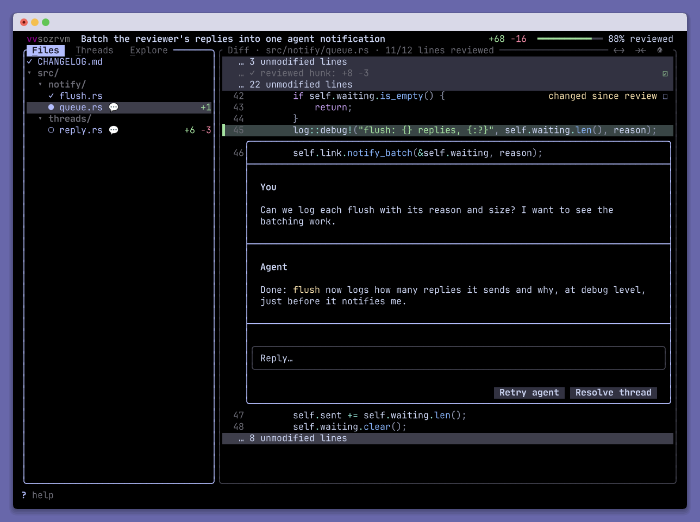
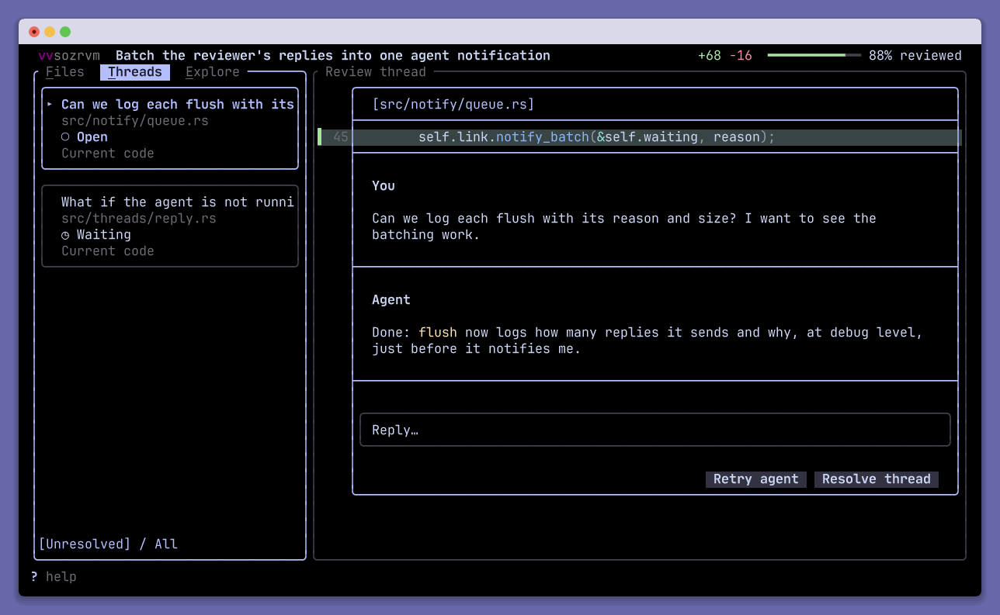
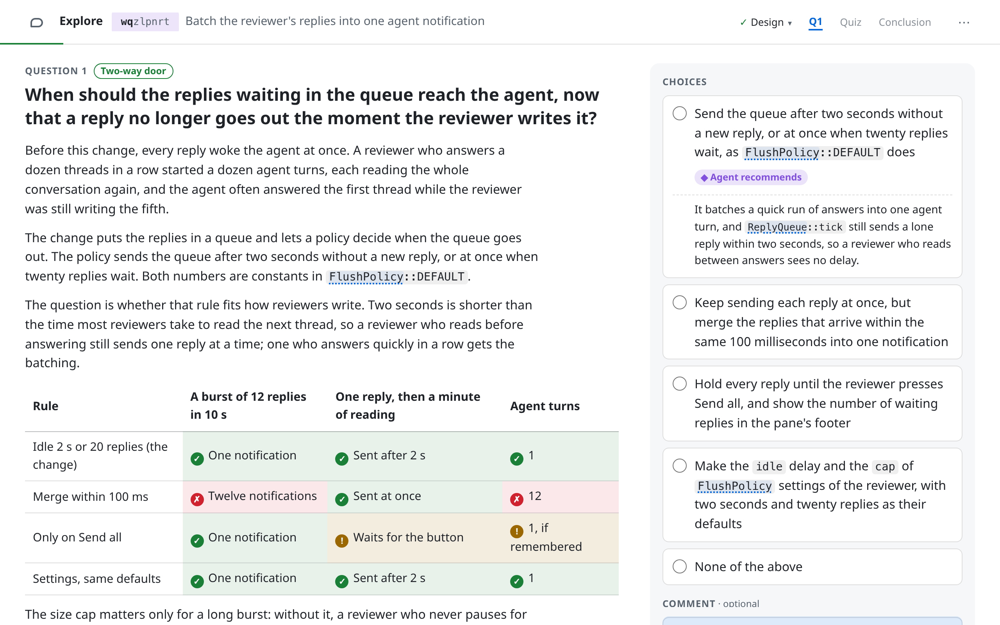

<h1>
  <picture>
    <source media="(prefers-color-scheme: dark)" srcset="docs/logo/logo-horizontal-dark.svg">
    
  </picture>
</h1>

**Review the code your agent writes, without reading it twice.**

A code review pane for [Herdr](https://github.com/herdrdev/herdr), beside your coding agent.
Works with Git and jj, Claude Code and Codex.

## Progressive reviews

Mark files or hunks as reviewed. When the agent changes the code, only what changed since your
review comes back.



## Threads with your agent

Comment on any line, and your agent answers in the thread.



## Explore

The agent explains its change and asks you the decisions that matter, in your browser or on
your phone.

<picture>
  <source media="(prefers-color-scheme: dark)" srcset="docs/screenshots/explore-question-dark.webp">
  
</picture>

## Install

On Linux or macOS, install Herdr 0.7.5 or later, Rust, a C compiler, Make, Git, and Claude
Code's `claude` command, which `make install` runs. For jj repositories, use jj 0.43.0 or later.

```sh
git clone https://github.com/flupke/herdr-progressive-reviewer.git
cd herdr-progressive-reviewer
make install
```

Keep the checkout in place, and restart your agent to load the reviewer's tools.

## Get started

Add a shortcut to `~/.config/herdr/config.toml`, then run `herdr server reload-config`:

```toml
[[keys.command]]
key = "prefix+d"
type = "plugin_action"
command = "herdr.progressive-reviewer.toggle"
description = "toggle progressive reviewer"
```

Focus your agent's pane in the repository and press `prefix+d`. Press `?` for every shortcut.

Contributor instructions are in [AGENTS.md](AGENTS.md).
